[English](README.md) · Português

<h1 align="center">Kabul</h1>

<p align="center">
  <strong>Cada agente de código no seu melhor, lado a lado.</strong><br>
  Rode Claude, GPT, Gemini, Qwen e modelos locais em paralelo, cada um no harness feito para ele, cada um no seu git worktree.<br>
  Troque de modelo sem perder a conversa. Chame um amigo para a sessão. Continue pelo celular.
</p>

<p align="center">
  <a href="https://github.com/valteracetto/kabul/actions/workflows/ci.yml"></a>
  <a href="https://github.com/valteracetto/kabul/releases"></a>
  <a href="LICENSE"></a>
  <a href="https://valteracetto.github.io/kabul/pt-BR/"></a>
</p>

<p align="center">
  
</p>

## Três coisas que o Kabul faz diferente

### 1. O harness certo para cada LLM

Um modelo rende o que o laço de agente em volta dele deixa render. O Kabul roda cada modelo no harness feito
para ele: Claude no **Claude Code**, GPT no **Codex**, Gemini no **Antigravity** ou no **Gemini CLI**, Qwen no
**Qwen Code**, e o resto pelo **OpenCode** ou pelo **Goose**, pelo
[Agent Client Protocol](docs/acp.md). Modelos locais são encaminhados pela família: um Qwen no LM Studio vai
para o Qwen Code, um DeepSeek servido com API compatível com a da Anthropic vai para o Claude Code, um gpt-oss
vai para o Codex. Você escolhe o modelo; o Kabul escolhe o harness e avisa quando precisou usar outro.

### 2. Trocar de LLM ou de conta na mesma conversa, na mesma branch

Bateu no limite, quer uma segunda opinião ou um modelo mais barato para a parte chata? Escolha outro modelo
na mesma conversa, mesmo de outro provedor ou de outra conta. O Kabul guarda um transcript canônico, que não
depende de harness, e passa o bastão para o agente novo: as últimas mensagens e quem escreveu cada uma,
ferramentas usadas, o diff da branch e as suas notas em `.context/`. Mesmo worktree, mesma branch, os
checkpoints continuam. Um divisor no chat mostra onde a troca aconteceu.

<p align="center">
  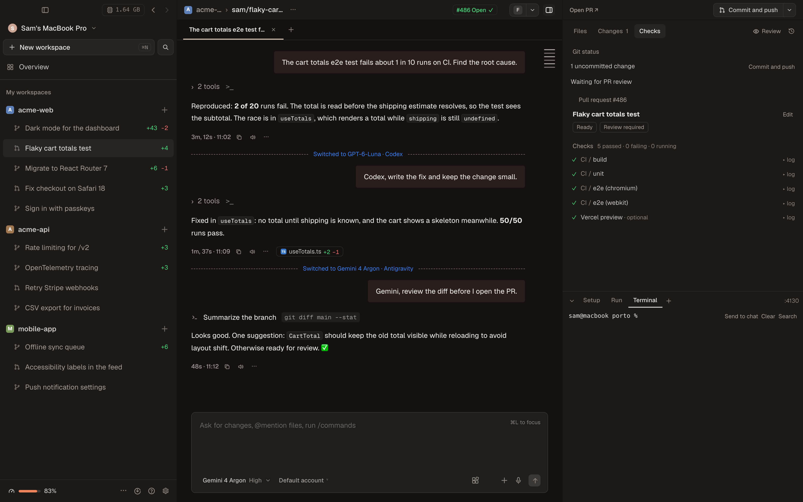
</p>

### 3. Trabalhar com um amigo ao mesmo tempo, e pelo celular

Convide alguém para um workspace como **editor** ou **observador**. Os dois veem o agente ao vivo, mandam
mensagens numa fila única, aprovam ferramentas (vale a primeira decisão) e digitam no mesmo terminal, com
presença e autoria em cada mensagem. O mesmo servidor leva todas as sessões do seu computador para o
celular: um app instalável para iOS e Android que mostra o que está rodando, o que espera por você, o diff e
os arquivos, e avisa quando um agente precisa de uma decisão.

<p align="center">
  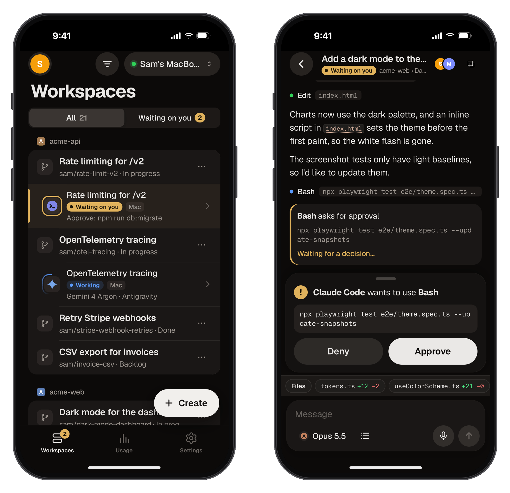
</p>
<p align="center">
  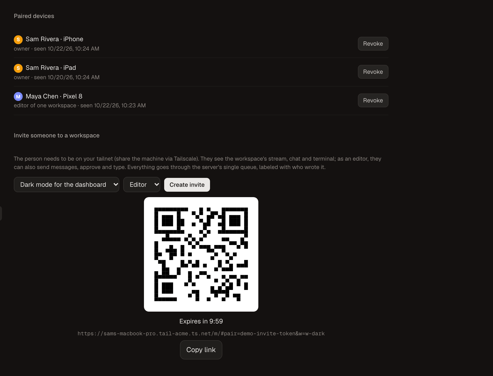
  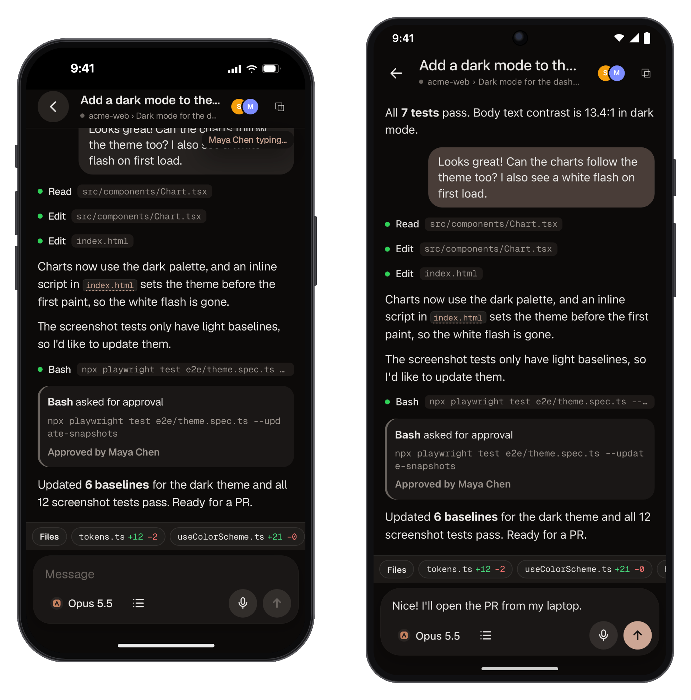
</p>

## Por que o Kabul

Os agentes de código já dão conta de várias coisas ao mesmo tempo. As ferramentas em volta deles, não: cada
agente vive no seu CLI, uma tarefa por terminal, preso à mesa e aos modelos de um fornecedor só.

O Kabul é a bancada em volta deles. Cada tarefa ganha um **workspace**: um git worktree na sua própria branch,
com portas, terminal e conversas próprios, para dez agentes trabalharem em dez coisas sem pisar um no outro.
Você revisa o diff, deixa comentários para o agente, acompanha os checks e entrega o pull request na mesma
janela. Modelos e contas se trocam no meio da conversa. E nada disso exige ficar na frente do computador.

O Kabul é local e de código aberto. O seu código fica na sua máquina; os agentes falam com os provedores que
você já paga, com os logins que você já tem. O Kabul nunca lê os seus tokens.

<p align="center">
  
</p>
<p align="center"><sub>Criar workspace → o Claude trabalha → trocar para o Codex na mesma conversa → aprovar → abrir o PR (<a href="docs/assets/demo.mp4">MP4</a>).</sub></p>

## Recursos

**Workspaces em paralelo com git worktree.** Uma tarefa, um worktree, uma branch. Dez portas reservadas por
workspace (`$KABUL_PORT`…`+9`), scripts de setup/run/archive do `.kabul/settings.toml`, arquivos `.env*`
copiados, status (Backlog → Concluído), seções, fixados e quadro. Arquivar guarda tudo num checkpoint e
remove o worktree; desarquivar traz de volta.

**Chat com aprovações e plano.** Cada ferramenta vira um cartão: aprovar uma vez (`↵`), sempre (`⌘↵`) ou negar
(`⌫`). Plan mode em todos os harnesses: nativo onde o CLI tem, emulado onde não tem, e aprovar o plano troca o
modo da sessão que está rodando, sem reiniciar. Perguntas, fila de mensagens, forks, reset, `@` arquivos,
`/` comandos, anexos e ditado offline.

**Diff, PR e checks.** Diff unificado ou lado a lado, com realce e comentários por linha que vão para o agente.
Um botão de git que acompanha o estado da branch: commit e push, criar PR, pull, corrigir checks que falharam
(com os logs), resolver conflitos, merge, arquivar. Checks e comentários de revisão no mesmo painel.

**Checkpoints.** O Kabul grava um checkpoint antes de cada mensagem enviada (refs privadas do git, sem mexer na
sua branch nem no `HEAD`). Restaure os arquivos de qualquer ponto ou volte a conversa até ele.

**Terminal.** Um terminal de verdade por workspace e terminais em aba inteira que já abrem o Claude Code, o
Codex, o Gemini ou o OpenCode. No macOS as sessões sobrevivem ao app (tmux).

**MCP compartilhado e por sessão.** O Kabul lê os servidores MCP que você configurou no Claude Code, Codex,
OpenCode, Gemini CLI, Qwen Code e Antigravity e oferece todos a todos os agentes, no formato de cada CLI, sem
mexer nas suas configs. Ligue e desligue por sessão, veja quantos tokens as definições custam por turno e
mantenha os segredos fora da linha de comando.

**Linear e GitHub.** Workspaces a partir de issues do Linear, `@` para citar issues, fechar pelo PR. GitHub pelo
`gh`: clonar, várias contas, PRs, checks e revisões. Rotinas rodam um prompt num horário ou num evento do PR.

**Nuvem do provedor.** Inicie uma sessão do Claude Code na nuvem da Anthropic a partir de um workspace,
acompanhe no Kabul e traga de volta para a sua máquina (teleport). Espelhe uma sessão local no app do Claude.
O controle remoto do Antigravity funciona do mesmo jeito.

**Celular: iOS e Android.** Um app instalável (PWA) servido pelo seu próprio computador pelo Tailscale:
sessões por workspace, terminal ao vivo, chat estruturado com aprovações, novos workspaces, seletor de modelo,
arquivos e diff com preview, o app que você está construindo por um proxy autenticado e notificações quando
um agente espera por você. Visual de iOS no iPhone, Material 3 no Android, um código só.

**Colaboração.** Convites com papéis (editor, observador) presos a um workspace, presença, "digitando…",
autoria por mensagem, fila única no servidor e aprovação em que vale a primeira decisão.

**Uso, custos e barra de menus.** Tokens e custo por workspace, sessão, modelo, conta e provedor; janelas de
5 horas, semana e mês com contagem regressiva; alertas por porcentagem ou orçamento diário, com sugestão de
trocar para uma conta ou modelo com folga. Um ícone na barra de menus (bandeja) mostra os limites mais
apertados e os agentes rodando agora. Exporta CSV.

**Modelos locais com o melhor harness.** Acha servidores do LM Studio, Ollama, llama.cpp, vLLM e MLX, mostra o
que cabe na memória, baixa modelos depois da sua confirmação e encaminha cada família para o harness que roda
melhor.

**ACP.** Um harness fala o Agent Client Protocol e cobre Gemini CLI, Qwen Code, OpenCode, Goose e Cursor com o
mesmo chat, os mesmos cartões e aprovações, sem um parser por CLI. Um agente ACP novo é uma entrada pequena, não
uma integração nova.

**Desempenho em escala.** Feito para 100 workspaces e 30 agentes ao mesmo tempo: só o workspace visível fica
montado, os eventos chegam em lote por quadro, listas longas são desenhadas por blocos e um limite de agentes
simultâneos põe os outros numa fila, com o workspace em foco na frente. Orçamentos medidos rodam no CI.

**Segurança.** O servidor do celular só escuta no localhost e na sua tailnet, pareia aparelhos com QR de uso
único e chaves por aparelho guardadas no cofre do sistema, prende convidados a um workspace e serve os
previews em sandbox. Segredos nunca vão para a linha de comando. [Modelo de ameaças](docs/security.md).

### Capturas

| | |
|---|---|
| 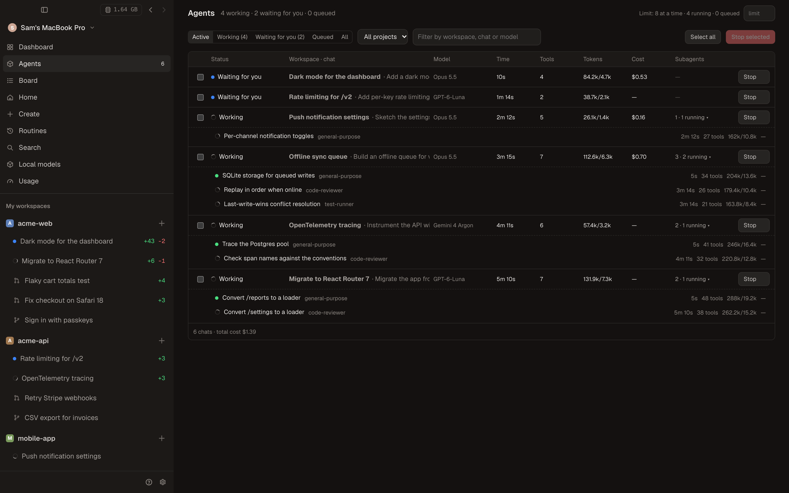<br><sub>**Agentes**: todas as conversas de todos os workspaces, com os subagentes</sub> | <br><sub>**Uso**: custo por dia, limites por conta e um aviso antes de bater em um</sub> |
| 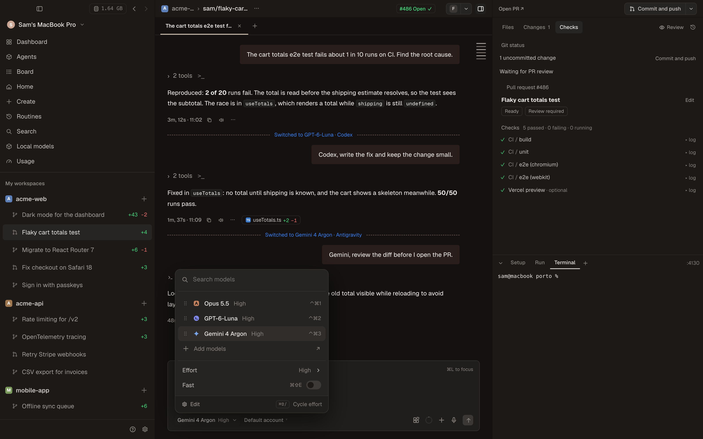<br><sub>**Seletor de modelo**: Claude, GPT e Gemini na mesma conversa</sub> | 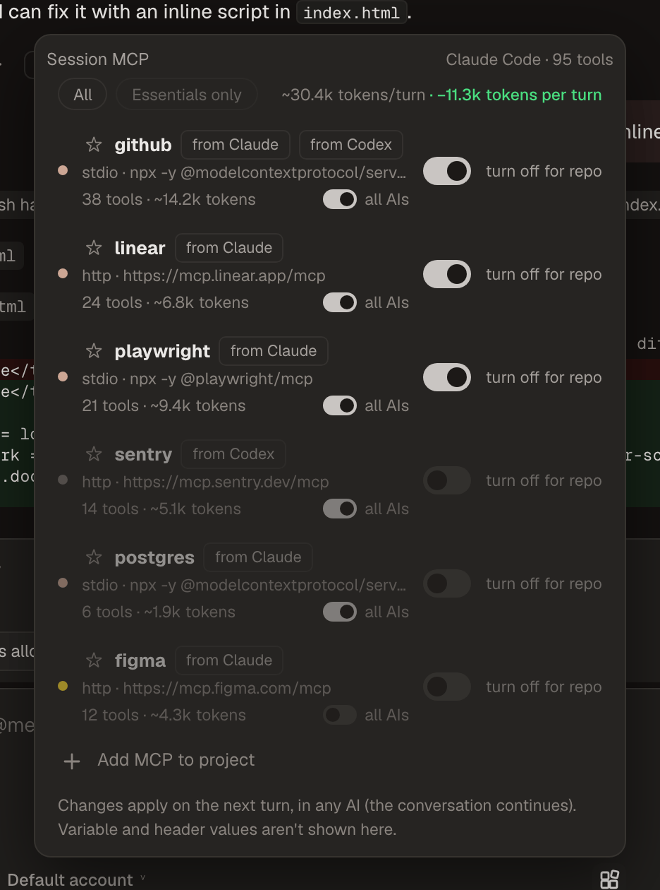<br><sub>**MCP**: um registro para todas as IAs e os tokens economizados por turno</sub> |
| <br><sub>**Quadro**: workspaces por status</sub> | <br><sub>**Barra de menus**: limites e agentes rodando num relance</sub> |
| 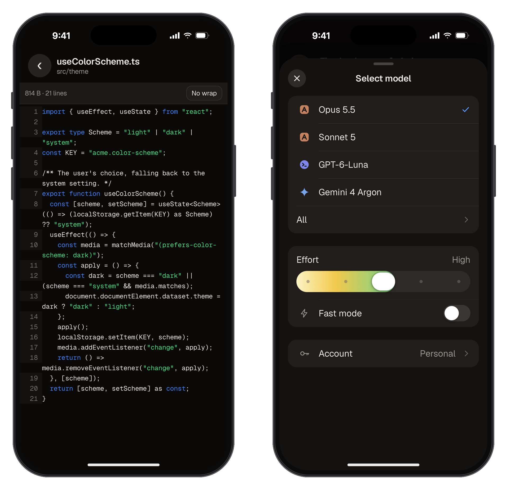<br><sub>**Celular**: arquivos com prévia, seletor de modelo</sub> | 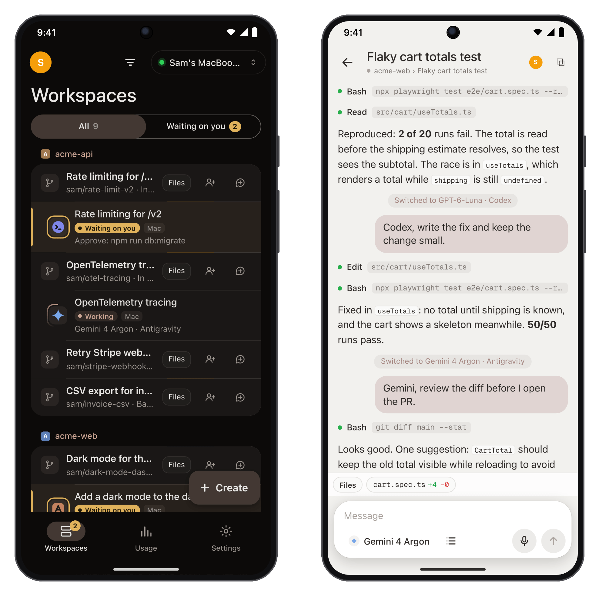<br><sub>**Android**: Material 3, o mesmo app</sub> |
| 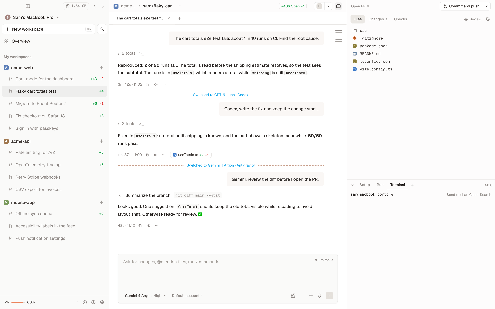<br><sub>**Tema claro**</sub> | 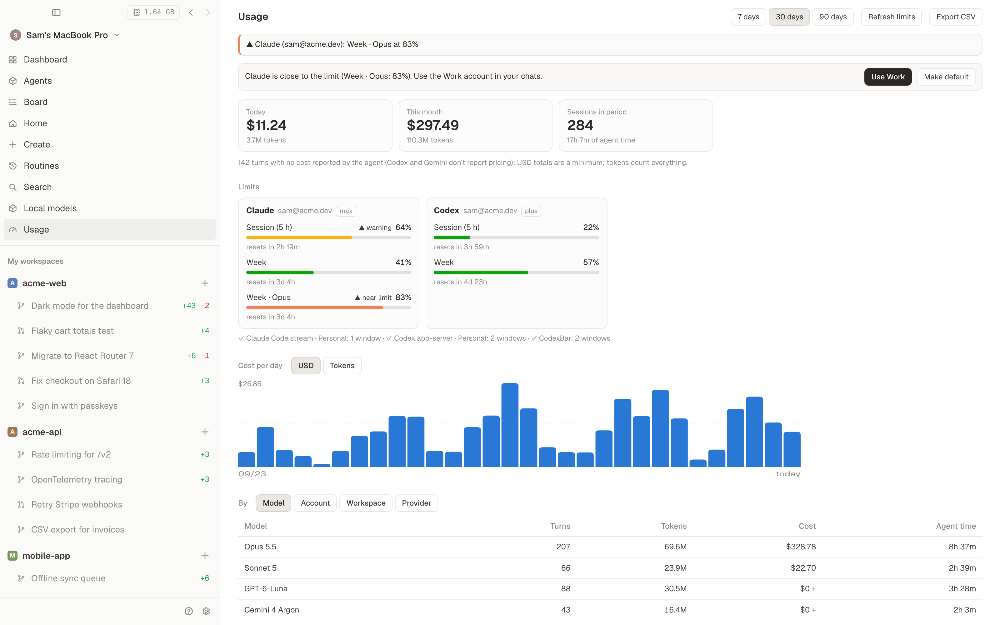<br><sub>**Tema claro**: Uso</sub> |

<sub>As capturas são de um ambiente de demonstração com dados inventados, em inglês (`npm run demo:capture` em `apps/web`).</sub>

## Agentes suportados

✅ confirmado rodando o CLI instalado pelo Kabul · ◐ parcial · ❔ ainda não confirmado · — não disponível

| Agente | Como o Kabul fala com ele | Chat e ferramentas | Aprovações | Plan mode | Parar | Retomar | Várias contas | Modelos locais | Celular |
|---|---|---|---|---|---|---|---|---|---|
| Claude Code | stream-json (nativo) | ✅ | ✅ | ✅ nativo | ✅ | ✅ | ✅ | ✅ API Anthropic | ✅ + controle remoto nativo |
| Codex | app-server (nativo) | ✅ | ✅ | ✅ nativo | ✅ | ✅ | ✅ | ✅ API Responses | ◐ |
| Antigravity (`agy`) | stream-json (nativo) | ✅ | ✅ regras do projeto | ◐ reinicia para sair | ◐ | ✅ | ✅ | — | ✅ + controle remoto nativo |
| Gemini CLI | ACP | ✅ | ✅ | ✅ nativo | ✅ | ✅ | ✅ ¹ | ◐ só gateways da API do Gemini | ◐ |
| Qwen Code | ACP | ✅ | ✅ | ✅ nativo | ✅ | ✅ | ✅ | ✅ API OpenAI | ◐ |
| OpenCode | ACP | ✅ | ✅ | ◐ emulado | ✅ | ✅ | ❔ | ✅ OpenAI / Anthropic | ◐ |
| Goose | ACP | ✅ | ✅ | ◐ emulado | ✅ | ✅ | ✅ | ✅ API OpenAI | ◐ |
| Cursor (`cursor-agent`) | ACP | ❔ | ❔ | ❔ | ❔ | ❔ | ❔ | — | ❔ |

¹ Perfis isolados funcionam; entrar com a conta Google pelo Kabul ainda não foi testado de ponta a ponta.
"Celular ◐" quer dizer que o celular recebe o mesmo chat estruturado do desktop, mas só o Claude tem teste de
ponta a ponta na tela do celular. Qualquer agente, e qualquer shell, também pode ser acompanhado e operado pelo
celular pelo espelho do terminal. Matriz completa e detalhes: [Agentes e harnesses](docs/pt-BR/guia/agentes.md)
e [ACP](docs/acp.md).

## Instalação

### macOS

Requisitos: macOS 14 ou mais novo (Apple Silicon ou Intel), `git`, `tmux` e o GitHub CLI.

```sh
brew install git tmux gh
```

1. Baixe o `.dmg` do seu Mac em [Releases](https://github.com/valteracetto/kabul/releases) e arraste o
   **Kabul** para Aplicativos.
2. Instale pelo menos um agente, por exemplo `npm install -g @anthropic-ai/claude-code` ou
   `npm install -g @openai/codex`. O Kabul também instala um CLI que falte em **Configurações › Contas**.
3. Abra o Kabul e entre nos agentes e no GitHub em **Configurações › Contas**. O Kabul roda o login do próprio
   CLI; ele nunca vê a sua senha nem lê os seus tokens.

Se uma versão ainda não estiver notarizada, o macOS bloqueia a primeira abertura: tente abrir o Kabul uma vez e depois
vá em Ajustes do Sistema › Privacidade e Segurança › **Abrir Mesmo Assim** (só na primeira vez). O app se atualiza sozinho
(canais estável e beta).

### Windows (beta)

O Kabul compila e roda no Windows 10 1809+ e 11 (instalador `.msi` ou `.exe` em
[Releases](https://github.com/valteracetto/kabul/releases)). Os terminais usam ConPTY no lugar do tmux, os
segredos vão para o Gerenciador de Credenciais e os scripts rodam no Git Bash. É **beta**: as sessões de
terminal ainda não sobrevivem ao fechar o app, a barra de título e alguns atalhos ainda são os do macOS e
alguns instaladores de CLI precisam do Git Bash. Veja em [Windows](docs/pt-BR/guia/windows.md) o que funciona e
o que falta.

Linux não tem pacote. O core e o servidor compilam lá, mas o app desktop não é testado no Linux.

### A partir do código

```sh
cargo test
cd apps/web && npm ci && npm run build
cd ../desktop && npx tauri build
```

## Início rápido

1. **Adicione um projeto.** `⌘N` › abra uma pasta git local, escolha um repositório do GitHub (clonado com o
   seu login do `gh`) ou comece um vazio.
2. **Descreva a tarefa.** Escreva o que quer e tecle `↵`. O Kabul cria o worktree e a branch, copia os seus
   `.env*`, roda o script de setup e manda a mensagem para o agente.
3. **Escolha o modelo.** `⌘/` abre o seletor: Claude, GPT, Gemini, Qwen e os seus modelos locais lado a lado.
   Troque quando quiser; a conversa continua.
4. **Conduza e revise.** Aprove ou negue as ferramentas, leia o diff no painel da direita, comente uma linha e
   mande os comentários para o agente.
5. **Entregue.** **Criar PR** (`⌘⇧P`), acompanhe os checks, deixe o agente corrigir as falhas, faça o merge e
   arquive.

Depois ligue **Configurações › Celular e remoto** para parear o celular com um QR. Passo a passo completo no
[início rápido](docs/pt-BR/guia/inicio-rapido.md).

## Perguntas frequentes

**O Kabul é gratuito?** Sim, licença MIT. Você usa as suas assinaturas ou chaves de API dos agentes (Claude,
ChatGPT, Google, modelos locais…). O Kabul não revende nem intermedeia acesso a modelos.

**O meu código sai do computador?** Só o que os agentes mandam para os provedores deles e o que o `gh` manda
para o GitHub, exatamente como se você rodasse esses CLIs. O Kabul não tem servidor próprio nem telemetria.

**Preciso do Tailscale?** Só para o celular, outras máquinas e colaboração. O servidor do celular escuta no
localhost e na sua tailnet, nunca na internet aberta.

**O Kabul substitui os CLIs dos agentes?** Não. Ele conduz os CLIs de verdade (Claude Code, Codex,
Antigravity…), então você mantém o comportamento, as atualizações, os logins, as configurações e os
servidores MCP de cada um.

**Um amigo convidado vê os meus outros repositórios?** Não. O convite fica preso a um workspace. Mas um editor
roda comandos com o seu usuário (terminal e aprovações), então só convide como editor quem você deixaria usar
o seu computador.

**A interface está em português?** Sim, e em inglês. O app desktop, o app do celular, os menus e as notificações
seguem o idioma do sistema; para escolher, vá em Configurações › Geral › Idioma (Sistema, English ou Português).

**Tem app do celular nas lojas?** Ainda não. O app do celular é uma PWA que você instala pelo navegador; as
versões para as lojas estão no roadmap.

Mais nas [perguntas frequentes](docs/pt-BR/guia/faq.md).

## Roadmap

- **Nuvem Kabul:** convidar pessoas e chegar nas suas sessões sem Tailscale; rodar o servidor do Kabul numa VM
  para qualquer agente trabalhar longe do seu computador.
- **Apps na App Store e no Google Play,** a partir do mesmo código, com push nativo.
- **Windows fora do beta:** sessões de terminal que sobrevivem ao app, atalhos com Ctrl e barra de título do
  Windows, instaladores em PowerShell para todos os CLIs, E2E no Windows no CI.
- **Handoff:** histórico gravado no transcript canônico e resumo pelo `/compact` do próprio agente na troca.
- **Mais agentes:** listar os modelos dos agentes ACP pelo próprio agente, confirmar o Cursor, status de login
  real do Gemini CLI, Qwen Code e Goose.
- **Observabilidade opcional:** traces e métricas OpenTelemetry (só metadados, desligado por padrão) para o seu
  próprio coletor.
- **1.0** quando a paridade de recursos, o Windows e o celular estiverem estáveis.

## Como contribuir

Issues e pull requests são bem-vindos. Comece pelo [CONTRIBUTING.pt-BR.md](CONTRIBUTING.pt-BR.md) (commits,
versões, CI e releases) e pelo [guia de contribuição](docs/pt-BR/guia/contribuir.md) (estrutura, comandos e
regras). Falhas de segurança: reporte em particular, veja o [SECURITY.md](SECURITY.md).

## Créditos

Partes dos recursos de uso e da barra de menus foram baseadas em ideias do
[CodexBar](https://github.com/steipete/CodexBar), de Peter Steinberger (MIT). O código do Kabul é próprio.
Veja os créditos completos em [ACKNOWLEDGMENTS.md](ACKNOWLEDGMENTS.md#português).

## Licença

[MIT](LICENSE)
