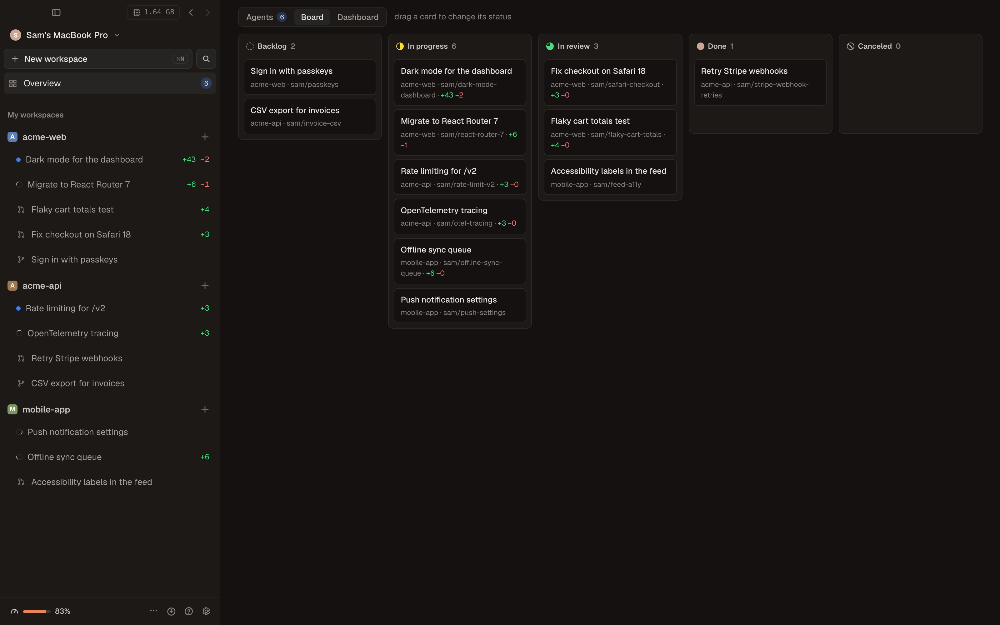

English · [Português](../pt-BR/guia/conceitos.md)

# Concepts

**Project (repository).** A git repository you added. Kabul never changes the main checkout; it creates
worktrees next to it.

**Workspace.** One task. A git worktree in `~/kabul/workspaces/<project>/<city>` on its own branch, with ten
reserved ports (`KABUL_PORT` … `KABUL_PORT+9`), a terminal, setup/run scripts and any number of chats.
Workspaces have a status (Backlog, In progress, In review, Done, Canceled), can be pinned, grouped in
sections, marked unread and archived. Archiving saves every change in a checkpoint and removes the worktree;
unarchiving brings it back. The **Board** shows workspaces by status.

**Branch and target branch.** New workspaces branch from the base branch (the default branch, or the one set
in **Settings › Git**). The target branch (shown as `→ main` next to the branch) is what the diff and the pull
request compare against.

**Chat (session).** A conversation with an agent inside a workspace. A workspace can have many, in tabs (split
side by side with `⌘D`). Each chat has a model, an account, a mode (default, plan, accept edits, approve
everything) and a queue for messages sent while the agent is busy.

**Browser.** Each workspace has its own isolated Chromium, shown live in the Browser tab (`⌘⇧B`) and
driven by every agent through the built-in `kabul-browser` MCP server. See [Browser](./browser.md).

**Harness.** The command-line agent that runs a model: Claude Code, Codex, Antigravity, Gemini CLI, Qwen Code,
OpenCode, Goose or another [ACP](../acp.md) agent. Kabul drives the real CLI, so you keep its behavior, its
updates and your settings. Local models go to the harness chosen by the
[family registry](./local-models.md#the-family-registry).

**Transcript.** Kabul's own record of a chat, independent of any harness: every message with its author
(you, a guest, an agent with its model), tool calls, approvals, handoffs and turn usage. It is what lets you
[switch model or account](./switching.md) mid-conversation, fork and reset.

**Checkpoint.** A snapshot of the worktree taken before every message you send, stored in private git refs
(`refs/kabul-checkpoints/…`) without touching your branch or `HEAD`. Restore one from the message or from the
**Checkpoints** tab of the right panel; later changes are discarded.

**Where it runs.** Each chat shows where it runs: on this computer, in the provider's cloud (Claude Code's
cloud sessions) or on another machine running `kabuld`.

**Accounts.** You can keep several logins per provider (for example a personal and a work Claude account).
Each profile has an isolated configuration folder, and every chat shows which account it uses.

**Machines and `kabuld`.** `kabuld` is Kabul's server. Turned on, it mirrors every session of the computer to
your phone, to other machines and to invited guests. The machine picker at the top of the sidebar switches the
whole app to another machine (`⌃1` … `⌃9`).

**Roles.** You are the **owner** of your machine. Paired devices of yours are owners too. Guests join one
workspace as **editor** (can send messages, approve and type) or **observer** (read only). See
[Collaboration](./collaboration.md).

