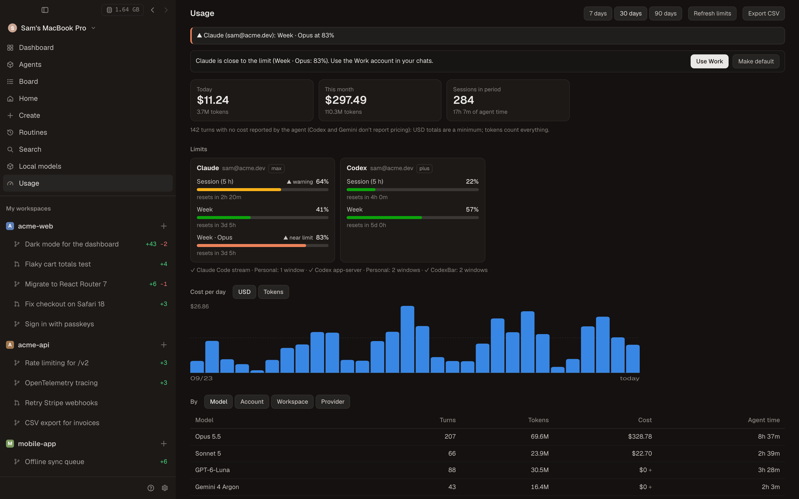
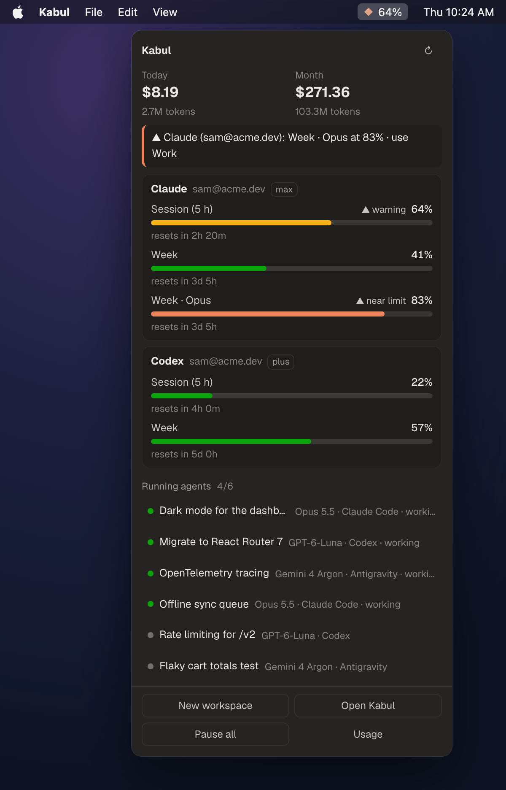

English · [Português](../pt-BR/guia/uso.md)

# Usage, costs and limits

Kabul keeps track of what your agents spend and how close each account is to its limits.

## Where the numbers come from

1. **Every turn Kabul runs** (desktop app, the server used by your phone, `kabul serve`): tokens (input, output, cache read and written), duration and cost when the harness reports it. Claude Code reports cost; Codex and Gemini do not, so their turns count tokens only and dollar totals are a lower bound. Only metadata is stored (provider, model, account, workspace, session), never prompts, code or paths.
2. **The agents themselves**: Claude Code sends its 5-hour and weekly windows in the stream (`rate_limit_event`); Codex sends `account/rateLimits/updated`, and Kabul also asks its app-server (`account/rateLimits/read`) for every Codex account you added.
3. **CodexBar CLI, if installed** ([CodexBar](https://github.com/steipete/CodexBar), MIT): `codexbar usage --format json --status` adds more providers, provider status and credits. Turn it off in Settings › General.

Turns live in `usage.jsonl` and limits in `usage-limits.json`, both in Kabul's state folder, each with a `schema_version`.

## The Usage tab

Sidebar › **Usage** (also on the phone, from the session list):

- spend and tokens today and this month;
- one block per provider/account with a bar per window (session, week, month) and the countdown to the reset;
- a per-day chart (dollars or tokens) and tables by model, account, workspace and provider;
- sessions with duration, turns, tokens and cost (click to open the workspace);
- **Export CSV** (one turn per line; saved to Downloads on desktop).

## Alerts and switching before you hit a limit

Settings › General: warn at a percentage of any window (80% by default) and set a daily/monthly budget. Kabul notifies once per window.

When a window passes the threshold, the Usage tab suggests another account of the same provider (if one has room) or another provider. **Use** applies it to the open conversations of that provider on the next message, through the same path as [switching model or account](./switching.md): same conversation, same branch, with a handoff.

## Menu bar (tray)

An icon in the macOS menu bar (system tray on Windows) draws the two tightest limits as bars; on macOS the highest percentage shows next to it. Click it for a popover with the same blocks, today's and this month's spend, agents running now (click to open the workspace) and quick actions: new workspace, open Kabul, pause all, usage. Right click opens a menu with the same actions. Turn it off in Settings › General › Menu bar icon.
