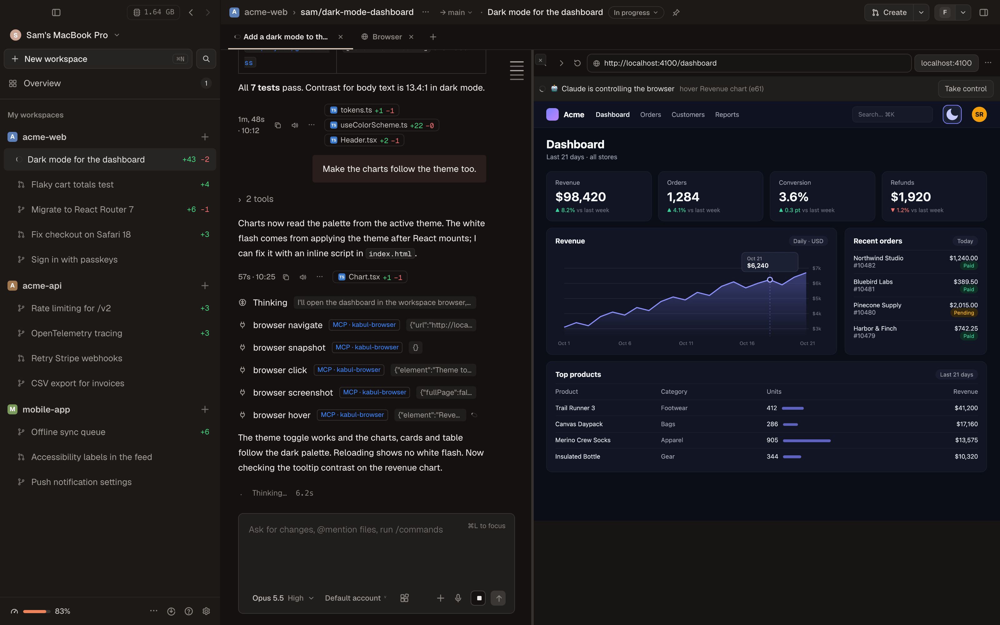

[English](../../guide/browser.md) · Português

# Navegador

Cada workspace tem o seu navegador: um Chromium que o Kabul controla pelo Chrome DevTools Protocol (CDP).
Você vê a página ao vivo na aba **Browser**, e todo agente usa exatamente a mesma página pelo servidor MCP
embutido `kabul-browser`, qualquer que seja o modelo ou o harness: Claude Code, Codex, Antigravity, Gemini
CLI, Qwen Code, OpenCode, Goose, Cursor e modelos locais. Você e o agente olham a mesma aba, e você pode
clicar e digitar nela enquanto o agente trabalha.



## Como abrir

- **`⌘⇧B`** no workspace abre a aba Browser.
- **`⌘⇧B` dentro de um terminal** (a aba Run ou qualquer aba de terminal) abre o último endereço
  `http://localhost:<porta>`, `127.0.0.1` ou `0.0.0.0` que apareceu naquele terminal: o servidor de
  desenvolvimento que você acabou de subir fica a um atalho.
- **"+" › Navegador** na barra de abas.
- **`kabul://browser?url=<url>`** abre a URL na aba Browser do workspace atual (serve em scripts, READMEs e
  notificações).

A aba tem barra de endereço (Enter abre; texto que não parece endereço vira busca), voltar / avançar /
recarregar, as abas do próprio navegador (nova, fechar, trocar), botões para as portas do workspace
(`$KABUL_PORT` a `$KABUL_PORT+9`) e a troca **desktop / celular**. O tamanho da página é um só: quando um
agente muda para celular, você também vê celular.

| Predefinição | Tamanho | |
|---|---|---|
| desktop | 1280 × 800 | padrão |
| laptop | 1440 × 900 | |
| tablet | 820 × 1180 | densidade 2×, toque |
| celular (mobile) | 390 × 844 | densidade 3×, toque |

## Você e o agente na mesma página

A página aparece como uma imagem ao vivo (screencast do CDP). Cliques, rolagem e teclado (com a área da
página em foco, inclusive colar) vão para a mesma aba do Chromium que os agentes usam.

Quando um agente age, a aba mostra **"_agente_ está controlando"** com a última ação. Dois botões:

- **Assumir controle** pausa os agentes: as ações (navegar, clicar, digitar, teclas, selecionar, rolar,
  evaluate, abrir/fechar/trocar abas, redimensionar) respondem "o usuário assumiu o controle do navegador" e
  o agente é orientado a esperar ou perguntar a você. As ferramentas de leitura continuam valendo.
- **Devolver ao agente** retoma.

**Ações dos agentes** lista o que cada agente fez (ferramenta, alvo, se deu certo), da mais antiga para a
mais nova. A mesma lista vai para `<estado>/browser/<workspace>/actions.jsonl` (cortado em 256 KB), e a
conversa mostra cada chamada de ferramenta como sempre.

### Por que screencast e não uma webview acoplada

- Há um Chromium headless por workspace, compartilhado por você e por todos os processos de agente. Uma
  webview dentro do app seria um segundo navegador, que os agentes não enxergam.
- As webviews do próprio app (WKWebView no macOS, WebView2 no Windows) não falam CDP com processos de
  fora; os agentes não conseguiriam controlá-las.
- A imagem é desenhada dentro da janela do app, igual no macOS e no Windows, sem janela nativa flutuando
  sobre a interface (redimensionar, dividir painéis e trocar de aba simplesmente funcionam).
- Os mesmos quadros servem o celular e o cliente web.

## Aprovações e política

**Configurações › Navegador › O que os agentes fazem sem perguntar:**

| Política | Navegação | `evaluate` (rodar JavaScript) |
|---|---|---|
| Sempre perguntar | todo endereço, menos `about:blank`, pergunta | pergunta |
| Permitir localhost e domínios do projeto (padrão) | `localhost`, `*.localhost`, `127.*`, `::1`, `0.0.0.0` e os domínios do projeto passam; qualquer outro site pergunta; `file:`, `data:`, `javascript:` sempre perguntam | pergunta |
| Permitir tudo | nada pergunta | não pergunta |

O pedido aparece na aba Browser (e como faixa no app, mesmo com a aba fechada) com **Permitir**, **Sempre
neste domínio** e **Negar**. "Sempre" guarda o domínio para este workspace. Sem resposta em 2 minutos conta
como negado, e o agente é orientado a não contornar.

A política é lida a cada ação: mudar vale na hora. Ela cobre a navegação direta, as abas novas abertas
pelo agente e toda navegação que uma ação do agente provoca dentro da página: link clicado, formulário
enviado, tecla, redirecionamento do servidor, link que abre outra aba (`target=_blank`). O Kabul pausa a
navegação no próprio navegador (CDP `Fetch`) antes de a requisição sair; negada, a página fica onde estava (e a
aba que a página tentou abrir é fechada). O que você digita na barra de endereço ou clica na aba Browser nunca
pergunta: é você.

### Domínios do projeto

Domínios que os agentes podem abrir sem perguntar (além de localhost) ficam nas configurações do repositório:

```toml
# .kabul/settings.toml
browser_hosts = ["staging.exemplo.com", "*.preview.exemplo.dev"]
```

`exemplo.com` vale também para os subdomínios; `*.exemplo.com` só para os subdomínios. Cada camada de
configuração soma à lista. Ela é lida quando a conversa começa.

### Modo plano

Uma conversa que começa em plan mode recebe o navegador só para leitura: `browser_snapshot`,
`browser_screenshot`, `browser_console`, `browser_network`, `browser_wait_for` e `browser_tabs` (só listar).
O navegador acompanha o modo da conversa: cada sessão recebe um arquivo-sinal (`--plan-flag`) que existe
enquanto ela está em plan mode, então aprovar o plano (ou trocar de modo) no app desktop libera as ações sem
reiniciar o agente. Sessões iniciadas pelo `kabuld` ficam no modo com que começaram.

## Perfil isolado por workspace

- O perfil fica em `<estado>/browser/<workspace>/profile` (`<estado>` é
  `~/Library/Application Support/kabul` no macOS, `%APPDATA%\kabul` no Windows e `$XDG_DATA_HOME/kabul` no
  Linux).
- Cookies, logins e armazenamento local persistem por workspace: faça login uma vez e todo agente daquele
  workspace continua logado. Um workspace nunca vê os cookies de outro.
- O Kabul **nunca abre o seu perfil pessoal do Chrome**, não carrega suas extensões, não sincroniza e não
  mexe no chaveiro do sistema (`--use-mock-keychain`, `--password-store=basic`).
- **Limpar cookies e sessões deste workspace** (menu da aba Browser, ou `kabul browser clear`) fecha o
  navegador e apaga o perfil.
- A porta do DevTools só escuta em `127.0.0.1` e é escolhida pelo sistema.

O navegador não pertence a nenhum agente: o primeiro que precisar (ou você) abre, os próximos conectam no
mesmo Chromium, e ele continua aberto até você usar **Fechar navegador** (ou `kabul browser stop`).

## Qual navegador é usado

O Kabul procura, nesta ordem:

1. `KABUL_BROWSER_BIN` (variável de ambiente);
2. o caminho em **Configurações › Navegador**;
3. o navegador baixado pelo Kabul (abaixo);
4. um navegador Chromium instalado:
   - macOS: Google Chrome, Chromium, Microsoft Edge, Brave, Chrome for Testing (em `/Applications` ou
     `~/Applications`);
   - Windows: Chrome, depois Edge, depois Chromium e Brave (em `Program Files`, `Program Files (x86)` e
     `%LOCALAPPDATA%`);
   - Linux: `google-chrome`, `chromium`, `microsoft-edge`, `brave-browser`.

Ele roda sempre **headless** e com perfil próprio: não aparece como janela nem mexe na cópia que você usa no
dia a dia.

**Nenhum navegador instalado?** Configurações › Navegador oferece **Baixar o navegador do Kabul**: depois da
sua confirmação, o Kabul baixa o `chrome-headless-shell` do
[Chrome for Testing](https://googlechromelabs.github.io/chrome-for-testing/) (o build oficial do projeto
Chromium para automação, última Stable, ~100 MB descompactado) para `<estado>/browser/bin/`. Nada é baixado
sem o seu consentimento. Pelo terminal: `kabul browser install`.

## O servidor MCP `kabul-browser`

É servido pelo próprio executável do Kabul (`kabul mcp browser --workspace <id>`; o app desktop e o
`kabuld` aceitam os mesmos argumentos) e entra no [registro único de MCP](./mcp.md#o-navegador-embutido-do-kabul)
com a origem "Kabul". Vai para todos os harnesses no formato de cada um, respeita o liga/desliga por sessão
e mostra o peso em tokens no painel de MCP (as definições vêm compiladas: não precisa "medir"). Desligue
para todas as IAs em **Configurações › Navegador**.

| Ferramenta | O que faz | Só leitura |
|---|---|---|
| `browser_navigate` | abre `url`, ou `go`: `back` / `forward` / `reload` | |
| `browser_snapshot` | árvore de acessibilidade em texto compacto; elementos interativos com `[ref=eN]`; `root` = só um trecho, `max_chars` (padrão 12.000) | ✓ |
| `browser_screenshot` | JPEG da área visível, da página inteira (`full_page`, até 8.000 px de altura) ou de um elemento (`ref`) | ✓ |
| `browser_click` | clique (`double`, `button`) | |
| `browser_type` | digita num campo (`clear`, `submit` = Enter depois) | |
| `browser_press` | tecla ou combinação (`Enter`, `Tab`, `Escape`, `ArrowDown`, `Control+a`), podendo focar `ref` antes | |
| `browser_hover` | mouse sobre um elemento | |
| `browser_select` | escolhe opções de um `<select>` pelo valor ou rótulo | |
| `browser_scroll` | rola até um elemento, ou a página por `dy`/`dx` | |
| `browser_wait_for` | espera `text` ou `selector` aparecer (ou sumir, `gone`), ou a rede ficar ociosa (500 ms sem requisição); `timeout_ms` (padrão 10 s, máx. 60 s) | ✓ |
| `browser_evaluate` | roda uma expressão JavaScript (aceita await) e devolve o valor em JSON, cortado em 4.000 caracteres; pode pedir aprovação | |
| `browser_console` | mensagens recentes do console e erros da página (`level`, `limit`, padrão 30) | ✓ |
| `browser_network` | requisições recentes: método, URL, status, tipo, tempo, tamanho (`failed_only`, `filter`, `limit`) | ✓ |
| `browser_tabs` | `list`, `new` (com `url`), `close`, `select` | ✓ (list) |
| `browser_resize` | `preset` desktop / laptop / tablet / mobile, ou `width` / `height` | |

Toda ferramenta que recebe `ref` aceita também um seletor CSS.

As saídas são curtas para economizar contexto: ações respondem uma linha ("Clicou em button "Salvar".
Página agora: …"), o snapshot é texto com papéis e nomes (cortado em `max_chars`, com a dica de usar
`root`), as capturas são JPEG. Uma ref é `e` mais o id do nó no Chromium: vale enquanto o elemento existir e
funciona no processo de qualquer agente; quando a página mudou, a ferramenta avisa e o agente tira outro
snapshot.

O **Claude Code** recebe as ferramentas do servidor já liberadas (`--allowedTools=mcp__kabul-browser`): a
aprovação é a política do Kabul acima, não um cartão por clique. Outros agentes podem mostrar também o
cartão de aprovação deles para ferramentas MCP, além da política do Kabul.

Console e rede começam a contar quando aquele agente conectou na página. O nome do agente em "está
controlando" vem do harness (ou do nome do cliente MCP).

### Pela linha de comando

```sh
kabul browser status            # navegador do workspace da pasta atual
kabul browser open http://localhost:5173
kabul browser stop
kabul browser clear             # fecha e apaga cookies/sessões
kabul browser install           # baixa o chrome-headless-shell (pergunta antes)

kabul mcp browser --workspace <id> [--home <estado>] [--agent <nome>] [--read-only] [--plan-flag <arquivo>] [--allow-host <domínio>]
```

Sem `--workspace` (ou com `--workspace auto`) o workspace é achado pela pasta atual: é o que você quer ao
registrar o servidor globalmente, como o Antigravity exige.

## Claude Code com o seu Chrome (opcional)

**Configurações › Navegador › Usar Claude Code com o Chrome** inicia o Claude Code com `--chrome`, para o
Claude também usar o seu Chrome de verdade, com os seus logins, pela extensão Claude in Chrome. É uma
alternativa só do Claude; o padrão para todas as IAs continua sendo o navegador do Kabul. O Kabul mostra se
o host nativo da extensão (`com.anthropic.claude_code_browser_extension`) está registrado; ele só confere
esse registro e nunca lê o seu perfil do Chrome.

## No celular

Numa sessão no celular (e no cliente web), a aba **Navegador** mostra uma imagem só de leitura da página,
atualizada a cada um ou dois segundos enquanto está visível, com a URL atual. Observadores convidados também
veem; ninguém controla o navegador por ali.

## Limitações

- Navegações que a página faz sozinha muito depois de uma ação do agente (um redirecionamento por timer
  segundos depois) não são interceptadas; a próxima ação do agente já vê o endereço novo.
- Console e rede mostram o que aconteceu desde que aquele agente conectou.
- O snapshot cobre o quadro principal; o conteúdo de iframes não aparece.
- O navegador continua aberto até você fechar pela aba Browser ou com `kabul browser stop`.
- No Windows o navegador foi implementado, mas ainda não testado numa máquina de verdade; veja
  [Windows](./windows.md#o-que-ainda-falta).
- Conferido de ponta a ponta (CLI instalado + LLM falso navegando, lendo e clicando) com Claude Code, Codex,
  Gemini CLI, Qwen Code e Goose. O OpenCode 2.1.4 não carregou os MCPs injetados no teste (o mesmo acontece
  com qualquer MCP compartilhado, não só o do navegador).
- O Qwen Code dá pouco tempo para cada MCP subir: na primeira execução de um binário recém-compilado (o macOS
  verifica o arquivo) o navegador pode não aparecer naquela sessão; a próxima já carrega.
